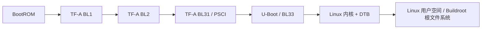

# QRK3588

QRK3588 是面向 Arm64 Cortex-A55/A76 平台的 Linux 系统软件项目，围绕 TF-A、U-Boot、Linux 和 Buildroot，提供从底层启动、板级驱动到根文件系统构建及业务代码部署的集成流程。板卡的主系统为 Linux，Quest OS 在其中作为基于 QEMU 运行的业务代码集成。

项目主要包含以下工作：

- **启动链适配**：适配 TF-A 的 BL1、BL2、BL31 和 U-Boot，涵盖固件加载、PSCI 多核启动与系统复位，并衔接 Linux 启动。
- **Linux 板级适配**：适配 QRK3588 设备树和驱动，覆盖串口、eMMC、时钟与复位、GPIO、引脚控制、PCIe 和以太网接入。
- **统一构建流程**：通过 `repo` 管理多个独立仓库，使用 Buildroot 生成共享 GCC/GDB 工具链，统一构建固件、Linux 内核、根文件系统和业务代码，并生成镜像校验和及构建身份记录。
- **升级与认证集成**：提供组件升级包和 U-Boot `qrk_upgrade` 命令，支持 TFTP、XMODEM 传输及写入后读回校验；集成 TF-A 固件认证，以及可选的 FIT 签名和 dm-verity 根文件系统校验。
- **业务代码集成**：通过 Buildroot 外部软件包树，将 Quest OS 镜像及其 QEMU 运行环境安装到 Linux 根文件系统，在 Linux 启动后按需运行，支持 KVM 加速和 TCG 软件模拟。

当前默认流程使用 eMMC 启动，调试串口为 UART2，参数为 **1500000、8N1**。板级配置针对本项目的 QRK3588 平台，移植到其他硬件时需核对设备树、DDR、引脚和存储布局。

## 项目结构

| 路径 | 用途 |
| --- | --- |
| `arm-trusted-firmware/` | TF-A，包含 BL1、BL2、BL31、PSCI 平台实现 |
| `u-boot/` | 引导 Linux、板级驱动及 `qrk_upgrade` 升级命令 |
| `linux/` | Linux 内核、QRK3588 设备树及平台驱动 |
| `buildroot/` | 交叉工具链、目标根文件系统及依赖包构建 |
| `apps/` | Buildroot 外部软件包树，名称为 `QRK_APPS` |
| `apps/quest_os/QuestOS/` | 基于 QEMU 运行的业务代码 Quest OS 的源码子模块 |
| `build/` | Python 构建流程、Shell 命令入口、打包和传输工具 |
| `build.sh` | 指向 `build/build.sh` 的工作区入口，由 manifest 创建 |
| `toolchain/` | 构建生成的共享 GCC 和 GDB |

工作区根目录用于组织这些仓库；查看改动和提交时，应进入对应子仓库，例如 `git -C linux status`。

## 获取源码

先安装 Git 和 `repo` 命令，再创建工作区：

```bash
mkdir qrk3588
cd qrk3588
repo init -u https://github.com/curia-x/qrk3588-manifests.git -b qrk3588
repo sync -j4
```

manifest 为各项目选择 `qrk3588` 分支，并开启子模块同步。TF-A 的 Mbed TLS 依赖以及 Quest OS 源码均需要完整同步。已有工作区可再次执行 `repo sync -j4` 更新源码，更新前先保存各仓库的本地改动。

## 主机环境

使用 Linux 主机，以普通用户执行构建。需要 Bash、Python 3、GNU make、Git、主机 C/C++ 编译工具、OpenSSL 和 e2fsprogs。首次构建还需要下载 Buildroot 软件包。

Debian/Ubuntu 的基础依赖安装示例：

```bash
sudo apt-get update
sudo apt-get install build-essential git curl wget rsync cpio unzip file bc \
    bison flex libssl-dev libncurses-dev python3 python3-dev openssl \
    e2fsprogs xz-utils bzip2 patch perl gawk texinfo
```

完整依赖随所选软件包变化。板卡升级另需串口访问权限；XMODEM 传输需要 `lrzsz` 提供的 `sx`，TFTP 传输需要可用的 TFTP 服务。启用操作系统认证时还需要 `veritysetup`。

## 快速构建

以下命令均在工作区根目录执行：

```bash
source build.sh

# 可选：限制构建并行度
export QRK_BUILD_JOBS=8

# 首次构建先生成共享交叉工具链
build_toolchain

# 构建并打包完整镜像，默认模式为 release
build_all release
```

`source build.sh` 只加载命令函数。`build_toolchain` 将 Buildroot 生成的工具链安装到 `toolchain/gcc/` 和 `toolchain/gdb/`，默认交叉编译前缀为 `aarch64-linux-gnu-`。当前工具链配置选用 GCC 15、GDB 16、glibc 和 Linux 7.2 headers。

`build_all` 依次构建 U-Boot、Linux、根文件系统和 TF-A，再生成完整升级包。它在主机上完成构建和打包，不连接板卡；也不会自动执行 `build_toolchain`。

可直接调用 Python 入口，适合脚本和 CI：

```bash
python3 build/build.py --help
python3 build/build.py build_all release
```

`build_all debug` 选择 TF-A 的 debug 模式，U-Boot 和 Linux 仍使用各自的配置。也可复用已有 ext4 根文件系统：

```bash
build_all release /path/to/rootfs.ext4
```

输入镜像须通过文件系统检查，大小不超过 128 MiB，且按 512 字节对齐。

## 构建产物

完整镜像集发布到 `build/out/images/release/`，debug 模式对应 `build/out/images/debug/`。默认配置下包含：

| 文件 | 用途 |
| --- | --- |
| `Image`、`linux.dtb` | Linux 内核和设备树 |
| `rootfs.ext4` | 根文件系统镜像 |
| `u-boot.bin` | 作为 BL33 的 U-Boot |
| `bl1.bin` | 原始 BL1 二进制 |
| `fip.bin` | 包含 BL2、BL31、BL33 等内容的固件包 |
| `complete.upg` | 包含 rootfs、kernel、dtb、fip 的完整升级包 |
| `build-identity.json` | 构建输入、配置和产物身份记录 |
| `artifacts.sha256` | 镜像集校验和 |

可在镜像目录执行 `sha256sum -c artifacts.sha256` 校验文件。该校验用于确认产物完整性，板卡启动和功能仍需单独验证。

`complete.upg` 不包含 BL1。USB MaskROM 下载使用的 ROM 格式 BL1 需通过 `build_bl1` 或 `build_atf` 生成，输出为 `arm-trusted-firmware/out/qrk3588_bl1.bin`；不能用原始 `bl1.bin` 直接替代。

常用组件输出目录：

| 路径 | 内容 |
| --- | --- |
| `u-boot/build/qrk3588/` | 常规 U-Boot 构建输出 |
| `linux/build/qrk3588/` | 常规 Linux 构建输出 |
| `buildroot/output/qrk3588-rootfs/` | 根文件系统构建输出 |
| `buildroot/output/toolchain-aarch64-linux-gnu-install/` | 共享工具链构建输出 |
| `build/out/rootfs.ext4`、`build/out/rootfs.tar` | 根文件系统构建后发布的镜像和归档 |
| `build/out/upgrade/` | 单项升级包 |

## 常用开发命令

加载 `build.sh` 后可使用：

| 命令 | 行为 |
| --- | --- |
| `build_uboot` | 构建 U-Boot |
| `build_kernel` | 构建 Linux `Image`、设备树和编译数据库 |
| `build_rootfs` | 构建 Quest OS、运行依赖和根文件系统，生成 ext4 与 tar |
| `build_bl1 [release\|debug]` | 构建 BL1 及 ROM 格式下载文件 |
| `build_fip [release\|debug]` | 使用已有 U-Boot 构建 FIP |
| `build_atf [release\|debug]` | 使用已有 U-Boot 构建 BL1 和 FIP |
| `menuconfig_uboot` | 调整 U-Boot 配置 |
| `menuconfig_kernel` | 调整 Linux 配置 |
| `menuconfig_rootfs` | 调整 Buildroot 配置 |
| `build_quest_os` | 通过 Buildroot 软件包构建或复用 Quest OS 镜像 |
| `install_quest_os` | 检查构建结果后将 Quest OS 镜像和启动器安装到 Buildroot 目标目录 |
| `clean_quest_os` | 清理 Quest OS 软件包构建状态 |
| `build_sdk` | 调用 Buildroot 原生 SDK 打包流程 |

单独执行 `build_fip` 或 `build_atf` 前，先运行 `build_uboot`。单独构建或安装 Quest OS 镜像不会重新生成 rootfs 镜像，需要随后执行 `build_rootfs`。

板级配置入口：

- [U-Boot defconfig](u-boot/configs/qrk3588_defconfig)
- [Linux defconfig](linux/arch/arm64/configs/qrk3588_defconfig) 与 [Linux 设备树](linux/arch/arm64/boot/dts/quest/qrk3588.dts)
- [Buildroot defconfig](buildroot/configs/qrk3588_defconfig)
- [TF-A 平台配置](arm-trusted-firmware/plat/quest/qrk3588/platform.mk)
- [Quest OS 所需的 Linux 宿主内核配置片段](apps/quest_os/configs/kernel.fragment) 与 [根文件系统配置片段](apps/quest_os/configs/rootfs.fragment)

构建入口会合入运行 Quest OS 所需的 Linux 宿主内核和根文件系统配置片段。`menuconfig_*` 生成的精简配置保存在对应输出目录的 `defconfig` 中；需要长期保留的配置应同步到源码配置文件。

## 启动与认证

默认启动流程：



板卡启动后进入 Linux 用户空间。Quest OS 业务由用户通过命令启动，其 QEMU 运行流程见下文。

默认 `QRK_ATF_SECURE_BOOT=1`，启用 TF-A 固件认证；`QRK_SECURE_OS=0`，操作系统认证需显式开启。两者分别控制固件认证与 Linux/rootfs 认证。

仓库提供的 `build/keys/qrk3588/development/` 密钥用于开发。使用独立信任根时，通过 `QRK_SECUREBOOT_KEYS` 指定自己的密钥目录。开启 `QRK_SECURE_OS=1` 后，流程生成签名 FIT 和 dm-verity 根文件系统，并要求匹配的完整镜像集，不支持部分升级。

## 板卡升级

升级依赖板端已能运行带 `qrk_upgrade` 命令的 U-Boot。首次上电或引导链损坏时，需要先使用适合硬件的 MaskROM/引导恢复流程，完整升级包本身不负责安装 BL1。

升级默认使用 TFTP 传输镜像，并通过串口控制 U-Boot。请先配置实际串口、TFTP 根目录和同一网络内的地址；以下仅为示例：

```bash
source build.sh
export QRKUPDATE_UART=/dev/ttyUSB0
export QRKUPDATE_TRANSPORT=tftp
export QRKUPDATE_TFTP_DIR=/srv/tftp
export QRKUPDATE_SERVERIP=192.168.10.1
export QRKUPDATE_IPADDR=192.168.10.2
export QRKUPDATE_TIMEOUT=900
```

TFTP 服务根目录须与 `QRKUPDATE_TFTP_DIR` 一致，且对当前用户可写。运行升级时，释放其他终端对该串口的占用。脚本等待 U-Boot 控制台；板卡正在运行 Linux 时，按脚本提示重启或重新上电。

```bash
# 完整构建并连接板卡，检查升级包与板端准入条件
upgrade_check release

# 完整构建并写入板卡 eMMC
upgrade release
```

`upgrade_check` 会传输镜像并在板端执行检查，不写入升级组件，但仍需要串口和板卡。`upgrade` 会覆盖包内对应的 eMMC 区域，包括 rootfs 内容；执行前保存需要保留的数据。默认非 OS 认证流程使用 `recover` 动作，OS 认证流程使用 `apply`。

只生成升级包、暂不连接板卡时：

```bash
build_linux_upgrade_package       # 内核和设备树：build/out/upgrade/linux.upg
build_kernel_upgrade_package      # 仅内核：build/out/upgrade/kernel.upg
build_dtb_upgrade_package         # 仅设备树：build/out/upgrade/dtb.upg
build_fip_upgrade_package release # FIP：build/out/upgrade/fip.upg
pack_rootfs_upgrade_package       # 打包已有 build/out/rootfs.ext4
```

`upgrade_kernel`、`upgrade_dtb`、`upgrade_boot`（内核和设备树）、`upgrade_fip` 和 `upgrade_rootfs` 会构建相应升级包并写入板卡。启用 OS 认证时请使用完整升级流程。

没有 TFTP 服务时，可设置 `QRKUPDATE_TRANSPORT=xmodem` 使用串口传输，需要安装 `sx`；其他板端升级前提相同。

## 运行业务代码 Quest OS

在本项目中，Quest OS 作为业务代码部署在 QRK3588 的 Linux 系统上，通过 QEMU 运行。构建流程将 Quest OS 镜像、QEMU 和启动器安装到 Linux 根文件系统；Linux 启动后，在板卡终端执行以下命令启动这项业务：

```sh
quest_os                 # 根据 /dev/kvm 访问权限选择 KVM 或 TCG
quest_os --accel kvm      # 显式使用 KVM
quest_os --accel tcg      # 显式使用软件模拟
```

启动器使用 4 个虚拟 CPU、1 GiB 内存和 GICv3，通过 QEMU `-bios` 加载 Quest OS。自动模式检查设备访问权限，不保证 KVM 初始化成功；显式 KVM 失败时不会自动回退。当前配置保留 Quest OS 的交互菜单，Linux init 不会自动启动它；按 `Ctrl-A` 后再按 `X` 退出 QEMU。

## 许可证

各组件保留各自的许可证及第三方声明，请以对应仓库中的 `LICENSE`、`COPYING` 和文件 SPDX 标识为准。安装 Quest OS 镜像时会将许可证与第三方声明放入目标系统的 `/usr/share/quest_os/licenses/`。
